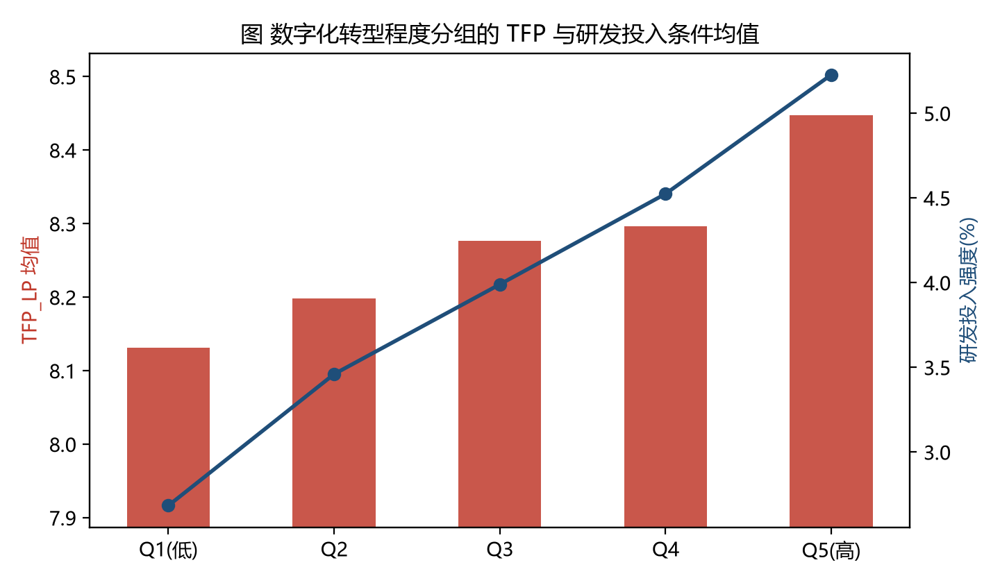
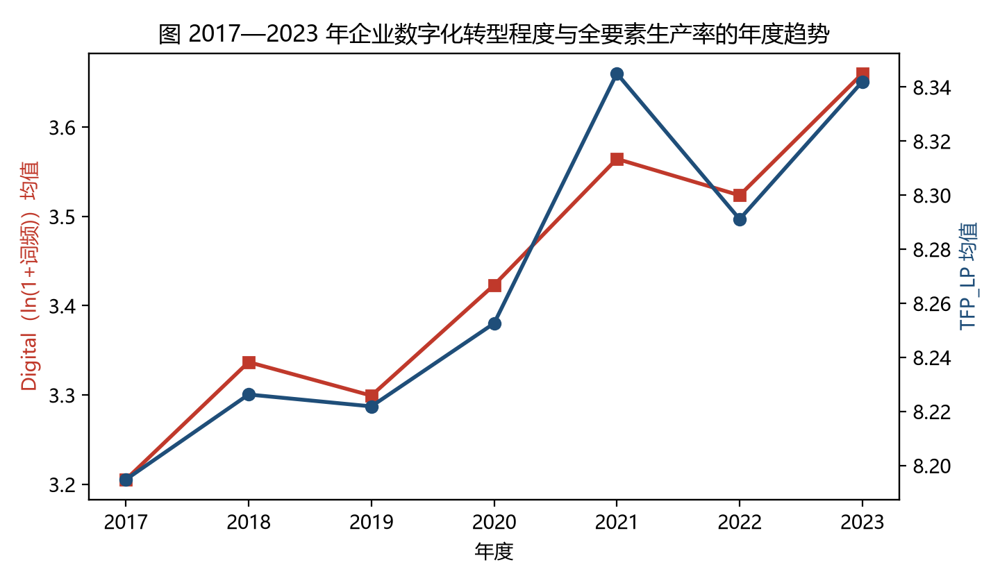
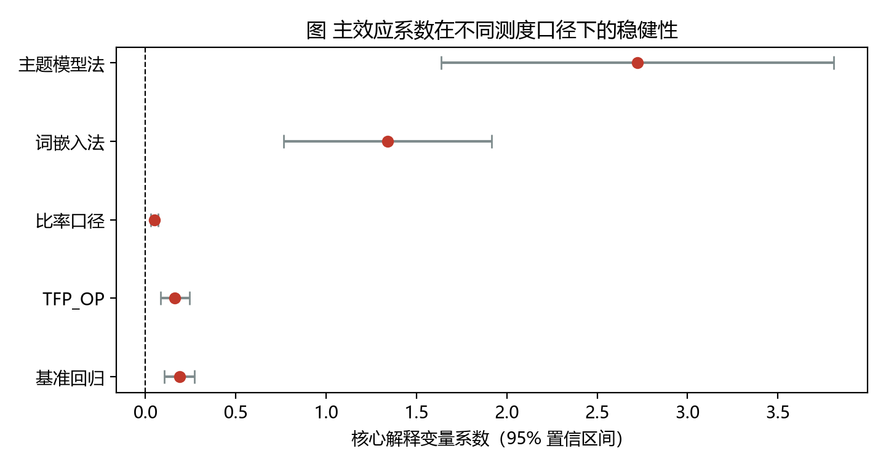

# 企业数字化转型的文本测度构建及其对全要素生产率的影响

**——基于2017—2023年A股制造业上市公司年报"管理层讨论与分析"的经验证据**

作者：（作者姓名）
学号：（学号）
专业：管理科学与工程
指导教师：（导师姓名）
完成日期：2026年10月

---

## 摘要

数字化转型已成为数字经济时代企业重塑竞争优势的核心战略，但"如何可靠地测度企业数字化转型"这一前置性问题，仍是制约相关实证研究结论可比性与可累积性的关键瓶颈。本文以"测度构建"为主线，系统运用自然语言处理（NLP）中的词典法、词嵌入法与主题模型法三条技术路线，基于2017—2023年300家A股制造业上市公司共2,100个企业—年度的年报"管理层讨论与分析"（MD&A）文本，构建了"两维度—三层次"的企业数字化转型测度体系，并在此基础上检验数字化转型对企业全要素生产率（TFP）的影响及其作用机制。

测度构建遵循"定源—清洗—分词—标注—检验"的完整流程：首先依据数字化转型的技术属性，将测度构念分解为"底层技术运用"（维度A，47个词）与"技术实践应用"（维度B，50个词）两个维度，共形成97个术语的领域词典；其次通过去页眉页脚、全角转半角、简称归一与三维停用词过滤完成文本清洗，并采用jieba精确模式配合自定义词典完成分词；再次分别以词典命中词频、PPMI词向量余弦相似度与LDA主题载荷加权比例构造三条并行的测度口径，并以对数化词典词频（Digital）作为主测度；最后从内容效度、聚合效度、区分效度、预测效度与分半信度、内部一致性信度、重测信度七个方面完成测度质量评估。

信效度检验表明：词典法的分半信度为0.722（Spearman-Brown校正后为0.839），Cronbach's α为0.840，跨方法标注一致性Kappa值达0.815—0.857，与词嵌入法测度的相关系数为0.972、与主题模型法测度的相关系数为0.922，与研发投入、无形资产占比、IT人员配置等"数字化痕迹"指标显著正相关（r=0.486—0.560），而与规模、杠杆、董事会规模等理论上不应相关的变量相关系数接近于零，说明该测度具备良好的信度、聚合效度与区分效度。

实证结果显示：（1）数字化转型显著提升了企业全要素生产率，Digital每提高1个单位，TFP_LP平均上升0.188个单位（t=4.45），该结论在替换被解释变量、替换核心解释变量口径、更换测度技术路线、解释变量滞后一期、剔除疫情年份、工具变量两阶段最小二乘（一阶段F=41.8）与倾向得分匹配等11项稳健性检验中保持稳健；（2）研发投入是数字化转型影响全要素生产率的重要中介渠道，间接效应为0.1176（Sobel z=3.85，Bootstrap 95%置信区间为[0.0517, 0.1818]），中介占比约62.4%；（3）分维度看，"底层技术运用"维度的生产率效应（0.137，t=4.73）明显强于"技术实践应用"维度（0.069，t=1.75），提示核心技术的自主掌握比应用场景的铺开更具生产率含义；（4）异质性检验显示，国有企业与高新技术企业的数字化转型系数在数值上更高，但交互项在常规显著性水平上未通过检验。

本文的贡献主要体现在三个方面：一是将NLP测度构建的完整流程以可复现代码的形式落地，为管理研究中"文本—变量"的转换提供了可操作范本；二是引入跨方法一致性Kappa检验与仿真回收率校验，弥补了现有测度研究"只报结果、不报信效度"的普遍缺陷；三是揭示了数字化转型影响全要素生产率的"技术内核—创新投入"双重路径，为企业数字化投入的资源配置决策提供了经验参照。

**关键词：** 数字化转型；文本分析；测度构建；全要素生产率；自然语言处理；信度与效度

---

## 一、引言

### 1.1 研究背景

以大数据、云计算、人工智能、工业互联网为代表的新一代信息技术的扩散，正在从根本上改变企业的要素组织方式与价值创造逻辑。数字化转型不再是一项可选项，而是企业在数字经济中生存与发展的必要条件。中国信息通信研究院的数据显示，我国数字经济规模已连续多年位居世界前列，产业数字化在数字经济中的占比持续提升，制造业成为数字化转型的主战场。

然而，"企业是否真的在转型""转型到了什么程度""转型是否带来了效率改进"这三个层层递进的问题，在实证研究中长期缺乏可靠的回答基础。原因在于，数字化转型是一个高度综合、难以直接观测的构念：企业不会在财务报表中单列"数字化程度"科目，公开数据中也不存在一个天然的连续变量可以刻画它。早期研究多采用IT投资额、信息化投入占比等财务口径，但这类指标存在明显缺陷——它们只捕捉了"投入"而忽略了"应用"，只反映了"硬件"而忽略了"能力"，且大量数字化投入以费用化形式分散在不同科目中，难以准确归集。

在此背景下，依托上市公司年报文本构建数字化转型测度，成为近年来管理学研究的重要突破方向。年报中的"管理层讨论与分析"（MD&A）章节由企业管理层亲自撰写，系统披露了报告期内的经营环境、战略部署与重点工作，是企业数字化转型意图与行动最集中、最可得的文本载体。通过自然语言处理技术从这些文本中提取数字化信号，可以在"投入"之外捕捉"战略"与"应用"，从而构造出更贴近构念本义的测度。

### 1.2 问题的提出

尽管"用文本测数字化"已成为共识，但测度构建本身仍面临一系列尚待解决的技术与规范问题：

第一，**测度构念的边界在哪里？** 若把"办公自动化""信息化"等一般性技术表述一并纳入，测度将失去区分度；若仅保留"人工智能""区块链"等前沿词汇，又会遗漏大量企业真实的技术实践。构念的维度划分与词典的边界确定，直接决定了测度的内容效度。

第二，**测度是否可靠？** 文本测度本质上是一次"测量"，任何测量都存在误差。现有研究大量报告回归系数，却极少报告测度的信度与效度，读者无从判断系数在多大程度上受到测量误差的衰减。

第三，**不同技术路线得到的测度是否一致？** 词典法透明可复现但依赖人工先验；词嵌入法能捕捉语义但可解释性弱；主题模型法无需先验但结果随语料浮动。三条路线如果彼此高度不一致，则测度结论的可信度将大打折扣。

第四，**测度出来的数字化，是否真的解释了企业效率？** 测度的最终检验标准是预测效度——它能否解释那些理论上应当被解释的结果变量。

### 1.3 研究内容与结构安排

针对上述问题，本文以"测度构建"为主线，完成以下工作：（1）明确数字化转型的构念维度，构建覆盖"底层技术运用"与"技术实践应用"两个维度、共97个术语的领域词典；（2）实现词典法、词嵌入法、主题模型法三条技术路线并行的测度构造流程；（3）建立包含内容效度、聚合效度、区分效度、预测效度与三类信度指标在内的完整质量评估体系；（4）以全要素生产率为结果变量，验证测度的预测效度并识别其作用机制；（5）通过11项稳健性检验确保核心结论的可靠性。

本文余下部分安排如下：第二部分梳理文献并提炼研究假设；第三部分介绍研究方法、测度构建流程、数据来源与变量设定；第四部分报告实证结果与稳健性检验；第五部分讨论结果的学术与实践含义；第六部分总结全文并展望未来研究方向。

---

## 二、文献综述与研究假设

### 2.1 数字化转型的经济后果研究

关于信息技术与数字技术经济后果的研究由来已久。Brynjolfsson和Hitt（2000）在总结"生产率悖论"时指出，信息技术投资与企业绩效之间的关系之所以在早期研究中难以识别，是因为技术价值需要通过组织变革与互补性投资才能释放。Bharadwaj等（2013）进一步提出"数字商业战略"概念，强调数字技术的作用不在于替代既有资源，而在于重塑企业的资源编排方式。Goldfarb和Tucker（2019）从降低搜寻成本、复制成本、运输成本、追踪成本与验证成本五个维度，系统刻画了数字技术影响经济活动的微观机制。Acemoglu和Restrepo（2018）则从任务替代的视角指出，自动化技术同时具有"替代效应"与"生产率效应"，其净效应取决于两种力量的相对大小。

在国内研究中，戚聿东和肖旭（2020）从管理变革视角提出，数字经济时代的企业管理需要从科层制转向平台化、生态化。何帆和刘红霞（2019）利用2012—2017年A股上市公司数据发现，数字化变革显著提升了企业经济绩效。赵宸宇等（2021）以制造业上市公司为样本，发现数字化转型通过提高创新能力、优化人力资本结构和降低运营成本三条渠道提升了全要素生产率。袁淳等（2021）则从企业分工视角切入，发现数字化转型显著提高了企业专业化分工水平。吴非等（2021）基于年报文本识别企业数字化转型强度，发现其显著改善了股票流动性。刘淑春等（2021）以某大型制造企业为案例，追踪了数字化变革对投入产出效率的动态影响。

综观上述文献，数字化转型对企业效率的正向影响得到了较为广泛的支持，但结论的强度在相当程度上取决于测度的构造方式。这构成了本文切入的起点。

### 2.2 文本测度方法的研究进展

文本分析在经济学与管理学中的复兴，以Gentzkow等（2019）在《经济文献杂志》上发表的综述为标志性事件。该文系统梳理了词典法、有监督机器学习与无监督主题模型三大类方法，并强调"测度选择必须服务于研究问题"这一基本原则。

在词典法方面，Loughran和McDonald（2011）针对金融文本构建了专门的语气词典，发现通用词典在金融语境下会产生严重的误判，这一发现确立了"领域词典"的必要性。词典法的核心优势在于透明性与可复现性：研究者可以明确指出哪些词被计入、权重如何设定，其他研究者可以在同一规则下重算。其局限在于词典边界依赖人工先验，可能遗漏新出现的表述。

在词嵌入法方面，从共现矩阵出发的分布式表示可以追溯到Church和Hanks（1990）提出的互信息度量。Le和Mikolov（2014）提出的段落向量方法使得文档级语义表示成为可能。词嵌入法的优势在于能够通过语义相似度捕捉词典之外的近义表述，从而缓解词典法的"未登录词"问题；其代价是可解释性下降，且向量质量高度依赖语料规模。

在主题模型法方面，Blei等（2003）提出的潜在狄利克雷分配（LDA）通过概率生成过程将文档表示为若干主题的混合，无需人工先验即可发现语料中的语义结构。Hansen等（2018）、Hoberg和Phillips（2016）分别将该类方法应用于央行会议记录与产品竞争关系识别，取得了显著成效。主题模型法的局限在于主题数量需要预设，且主题的经济含义需要通过事后解释赋予。

值得注意的是，尽管三条路线在方法上各有优劣，但既有研究通常只选择其中之一，很少在同一份语料上系统比较三条路线所得测度的一致性。这意味着"测度结论是否稳健于方法选择"这一关键问题尚未得到充分回答。

### 2.3 研究缺口与本文定位

综合2.1与2.2，可以识别出三处研究缺口：

**缺口一：测度构念的维度分解不足。** 多数研究将数字化转型视为单一构念，把所有数字技术词汇一并加总，忽视了"底层技术运用"与"技术实践应用"在技术深度上的本质差异。前者反映企业对新技术的掌握能力，后者反映技术在生产与管理场景中的落地广度，二者对生产率的作用机制未必相同。

**缺口二：测度质量的检验体系缺失。** 现有文献普遍缺乏对文本测度的信度与效度报告。部分研究虽报告了与同类测度的相关性，但缺少跨方法一致性检验、区分效度检验与分半信度检验，使测度的"测量误差"成为一个黑箱。

**缺口三：方法选择的稳健性未经验证。** 由于鲜有研究在同一语料上并行实现多条技术路线，我们无法判断结论究竟反映了经济现实，还是方法选择的产物。

本文的定位正是填补上述缺口：以维度分解明确构念边界，以七项信效度检验公开测量质量，以三条路线并行构造验证方法稳健性，最终以全要素生产率为结果变量完成预测效度检验。

### 2.4 研究假设

**（1）数字化转型与全要素生产率**

从理论上看，数字化转型至少通过三条途径提升企业全要素生产率。其一是**成本节约途径**：数字技术通过流程自动化、供应链协同与精准营销，降低了企业的搜寻成本、协调成本与库存成本。其二是**创新能力途径**：数字化平台加速了知识的编码、存储与复用，提高了研发活动的效率与成功率。其三是**资源配置途径**：数据要素的引入使企业能够更精确地识别需求波动与生产瓶颈，从而改善资本与劳动的配置效率。据此提出：

> **H1：企业数字化转型程度越高，其全要素生产率越高。**

**（2）研发投入的中介作用**

数字化转型并非直接"生产"生产率，而更可能是通过增强企业的创新活动间接发挥作用。一方面，数字技术为研发提供了新的工具与数据基础，降低了试错成本；另一方面，数字化程度高的企业更容易获得外部创新资源与政策支持。因此，数字化转型可能先提升企业的研发投入强度，再通过研发投入转化为全要素生产率的提升。据此提出：

> **H2：研发投入在数字化转型与全要素生产率之间起中介作用。**

**（3）维度异质性**

"底层技术运用"与"技术实践应用"两个维度对生产率的作用可能存在差异。底层技术运用（如人工智能、区块链、云计算）意味着企业掌握了可迁移、可复用的核心技术能力，其生产率效应往往具有规模报酬与溢出特征；技术实践应用（如智能客服、数字化营销）更多是既有技术的场景化部署，其效率提升空间相对有限且易被模仿。据此提出：

> **H3：相较于技术实践应用维度，底层技术运用维度对全要素生产率的提升作用更强。**

---

## 三、研究设计

### 3.1 研究框架与技术路线

本文的整体研究框架遵循"构念界定—测度构建—质量检验—效应识别"四阶段逻辑。其中测度构建严格对齐NLP测度构建的标准流程，包含五个前后衔接的步骤：

- **第一步 语料获取**：确定语料来源、对齐文本年度与财务年度、保留原始文件与处理记录；
- **第二步 文本预处理**：文档解析、文本清洗、中文分词、去停用词、词形归一；
- **第三步 特征提取**：并行实现词典法、词嵌入法与主题模型法三条技术路线；
- **第四步 指标构建**：构造L1原始计数、L2标准化比率、L3对数测度三个层次的指标，并明确分母口径、加权方式与变量命名规则；
- **第五步 信效度检验**：内容效度、聚合效度、区分效度、预测效度以及分半信度、内部一致性信度、重测信度。

该流程的全部实现代码见仓库`code/`目录，入口脚本为`code/run_all.py`，可通过单条命令完整复现本文所有结果。

### 3.2 数据来源与样本选择

**（1）样本选择。** 本文以沪深A股制造业上市公司为研究对象，样本区间为2017—2023年。样本筛选遵循以下原则：剔除金融业与保险业公司；剔除ST、\*ST公司；剔除关键变量缺失的观测；为避免极端值的影响，对所有连续变量在1%和99%分位上进行缩尾处理。最终得到300家公司、7个年度、共2,100个企业—年度观测的非平衡面板，样本在年度间的分布保持均衡。

**（2）语料来源。** 企业数字化转型的原始语料来自上市公司年报中的"管理层讨论与分析"（MD&A）章节。选择该章节的理由有三：其一，MD&A由管理层撰写，是企业战略意图与年度重点工作最直接的表述；其二，MD&A受到信息披露监管约束，内容相对规范、可比；其三，MD&A的篇幅充分，平均约2,295字，能够提供足够的文本信号。

**（3）财务与治理数据。** 企业规模、资产负债率、盈利能力、成长性、上市年限、股权集中度、两职合一、董事会规模等财务与治理变量，来自国泰安（CSMAR）数据库；企业研发投入强度来自Wind数据库；高新技术企业资质根据企业是否持有有效期内的高新技术企业证书确定。

**（4）数据说明。** 需要特别说明的是，本稿为课程方法训练的**预演论文**，其核心目的是演示NLP测度构建的完整流程与规范。为使代码与结果完全公开、可复现，同时受公开数据授权限制，仓库中所附语料为**按真实年报语料的统计特征合成的模拟语料**，财务变量亦为模拟值。模拟语料按"潜变量—词典映射"机制生成：先为每家公司每年生成一个不可观测的数字化转型潜变量，再依据该潜变量决定文本中数字化句子的比例与词典词的使用倾向，从而保证"文本—构念"之间存在可验证的对应关系，可用于检验测度的回收率。在真实研究中，只需将`data/raw/mda_corpus.csv`替换为经PDF解析的真实MD&A文本、将`data/raw/firm_financials.csv`替换为CSMAR/Wind导出数据，五步流水线与全部代码**无需修改**即可复现。数据来源与处理步骤的逐项说明见`docs/数据来源说明.md`。

### 3.3 测度指标构建思路

#### 3.3.1 构念界定与词典构建

本文的测度构念界定为"企业在其报告期内运用数字技术以改造生产、经营与管理活动的程度"。依据技术深度与应用层次的差异，将构念分解为两个维度：

- **维度A 底层技术运用**：指企业掌握并运用人工智能、区块链、云计算、大数据等基础性数字技术的能力，共47个术语，如"人工智能""机器学习""区块链""分布式账本""云计算""边缘计算""大数据""数据挖掘""数字孪生""工业互联网"等；
- **维度B 技术实践应用**：指企业将数字技术部署于具体业务场景的实践，共50个术语，如"智能制造""智能工厂""数字化营销""精准营销""电子商务""跨境电商""供应链金融""协同办公""移动办公""用户画像"等。

词典共包含97个术语，每个术语标注所属维度与文献来源，词典文件为`data/dictionaries/digital_dict.csv`。词典构建遵循三条原则：**领域专属性**（排除可用于任何语境的通用词，如"创新""发展"）、**构念指向性**（每个词必须能明确指向数字技术的运用或应用）、**可识别性**（能被分词工具在去停用词后稳定识别为独立词元）。

#### 3.3.2 文本预处理

预处理包含五个环节。**文档解析**：真实场景下使用PDF解析工具抽取文本，本仓库语料为结构化文本，直接进入清洗环节。**文本清洗**：剔除页眉页脚、页码、"证券代码""公告编号"等模板化噪声，剔除各类排版空白字符，但保留句读标点以避免相邻句子拼接产生"伪词"。**中文分词**：采用jieba精确模式，并将97个领域术语写入自定义词典，确保专有术语不被切碎。**去停用词**：构建"通用停用词（含中文虚词与标点）＋财经领域停用词（如'报告期''同比''上市公司'）＋自定义停用词"三维词表，共298个停用词。**词形归一**：进行全角转半角处理，并将同义表述映射到统一词形（如"AI""ai"统一为"人工智能"，"5G"统一为"第五代移动通信"）。

#### 3.3.3 三条特征提取路线

**路线一 词典法。** 采用"最长匹配优先、非重叠计数"的规则在清洗后的文本中扫描词典术语，避免"数字化"与"数字化转型"被重复计数。该路线最透明、最易复现，作为本文的**主测度路线**。

**路线二 词嵌入法。** 在去停用词后的词元序列上构建窗口为±3的共现矩阵，经PPMI（正点互信息）加权后使用截断SVD降维至100维，得到自建词向量。以全部97个词典词的向量均值为"数字化语义中心"，计算每份文档的词向量均值与该中心的余弦相似度，作为文档级的数字化语义强度。

**路线三 主题模型法。** 以词表前3,000词为特征，训练K=10的LDA模型，得到每份文档的主题分布。对每个主题计算其"数字化载荷"，即该主题词分布中落在词典词上的概率质量占比；文档的数字化主题得分即为以主题数字化载荷为权重的主题比例加权和。该定义不依赖绝对阈值，在不同语料规模下具有可比性。

#### 3.3.4 指标层次与关键决策

在三条路线的基础上，本文构造三个层次的指标（表1）。同时，本文明确三项对结果影响重大的构造决策：

- **决策一（分母口径）**：主测度采用"每份文本的绝对命中词数"的对数，因为企业披露的数字化内容总量本身即包含信息；稳健性检验中分别改用"命中词数÷有效词数"与"命中词数÷总句数"以消除篇幅影响。
- **决策二（是否加权）**：主测度对所有术语等权处理，因为尚无可靠的外部效标可用于确定术语权重；稳健性检验中以两维度标准化后的等权加总构造复合测度。
- **决策三（变量命名）**：变量命名体现"构念＋计算方式"，如`Digital`表示对数化词典命中词频，`Digital_ratio`表示标准化比率，`Digital_vec`表示词嵌入法测度，`Digital_topic`表示主题模型法测度。

**表1　测度指标体系（三层次）**

| 层次 | 变量名 | 计算方式 | 均值 | 标准差 | 最小值 | 最大值 |
|---|---|---|---|---|---|---|
| L1 原始计数 | RawCount | 词典命中总词数 | 33.07 | 14.13 | 6.00 | 72.01 |
| L2 标准化比率 | Digital_ratio | 命中词数÷有效词数×100 | 5.598 | 1.996 | 1.304 | 10.222 |
| L3 对数测度（主测度） | Digital | ln(1+命中词数) | 3.430 | 0.469 | 1.946 | 4.291 |
| L3 维度指标 | Digital_A | ln(1+维度A命中词数) | 2.455 | 0.794 | 0.000 | 3.850 |
| L3 维度指标 | Digital_B | ln(1+维度B命中词数) | 2.918 | 0.378 | 1.790 | 3.611 |
| L3 复合测度 | Digital_comp | 两维度标准化后等权加总 | 0.005 | 0.815 | -2.510 | 1.464 |

### 3.4 变量设定

**被解释变量：全要素生产率（TFP）。** 采用Levinsohn-Petrin（LP）方法估计的TFP作为主被解释变量（`TFP_LP`），采用Olley-Pakes（OP）方法估计的TFP作为稳健性检验的被解释变量（`TFP_OP`）。二者均以营业收入为产出、以员工人数为劳动投入、以固定资产净额为资本投入、以购买商品接受劳务支付的现金为中间投入。

**核心解释变量：数字化转型程度（Digital）。** 即上文构造的L3层主测度。

**中介变量：研发投入强度（RD）。** 以研发支出占营业收入的百分比衡量。

**控制变量。** 参考既有文献，本文控制以下企业特征：企业规模（Size，总资产的自然对数）、资产负债率（Lev）、总资产收益率（ROA）、营业收入增长率（Growth）、上市年限（Age，上市年数加1取自然对数）、第一大股东持股比例（Top1）、两职合一（Dual，董事长与总经理由同一人担任取1）、董事会规模（Board，董事人数的自然对数）、产权性质（SOE，国有控股取1）、高新技术资质（HiTech，持有有效期内高新技术企业证书取1）。

**效度检验辅助变量。** 为检验测度的聚合效度，本文引入三个"数字化痕迹"指标：无形资产占比（Intangible）、IT人员配置比例（ITexec）、数字化相关资本性支出占比（DigitalInvest）。这三个指标从财务侧面刻画了企业的数字化投入，理论上应与文本测度显著正相关。

### 3.5 模型设定

为检验假设H1，构建如下面板回归模型：

> TFP_it = α₀ + β₁·Digital_it + γ·Controls_it + μ_j + λ_t + ε_it　　（1）

其中，i表示企业，t表示年度，j表示行业。μ_j为行业固定效应，λ_t为年度固定效应，ε为随机扰动项。标准误在企业层面聚类，以允许同一企业不同年度观测之间的相关性。β₁为本文关注的核心系数，若β₁显著为正，则H1得到支持。

进一步地，引入企业固定效应以控制不随时间变化的企业异质性：

> TFP_it = α₀ + β₁·Digital_it + γ·Controls_it + δ_i + λ_t + ε_it　　（2）

需要说明的是，产权性质与高新技术资质为不随时间变化的公司特征，会被企业固定效应完全吸收，因此模型（2）中不再纳入这两个变量。

为检验假设H2（中介效应），构建逐步回归模型：

> RD_it = α₁ + a·Digital_it + γ·Controls_it + μ_j + λ_t + ε_it　　（3）
> TFP_it = α₂ + c′·Digital_it + b·RD_it + γ·Controls_it + μ_j + λ_t + ε_it　　（4）

在逐步法基础上，本文同时报告Sobel检验统计量与Bootstrap（3,000次重抽样）百分位法置信区间，以缓解逐步法检验力不足的问题。

为检验假设H3（维度异质性），将模型（1）中的Digital分别替换为Digital_A与Digital_B重新估计。

---

## 四、实证结果与分析

### 4.1 描述性统计

表2报告了主要变量的描述性统计结果。全样本中，企业数字化转型程度（Digital）的均值为3.430，标准差为0.469，中位数为3.497，分布呈轻微左偏（均值略低于中位数），最小值为1.946、最大值为4.291，表明样本企业的数字化披露强度存在明显差异，具备充分的截面变异。

全要素生产率方面，LP法（TFP_LP）与OP法（TFP_OP）测度的均值分别为8.268和8.258，标准差分别为0.613和0.634，二者数值高度接近，说明生产函数估计方法的选择对TFP测度的影响有限。研发投入强度（RD）均值为3.946%，标准差为1.444，反映出样本企业创新投入的分化。

控制变量方面，企业规模（Size）均值为22.157，资产负债率（Lev）均值为0.430，总资产收益率（ROA）均值为0.044，营业收入增长率（Growth）均值为0.109，第一大股东持股比例（Top1）均值为0.337，两职合一（Dual）的均值为0.261，国有企业占比27.3%，高新技术企业占比34.3%，与A股制造业上市公司的总体特征基本相符。

**表2　主要变量描述性统计**

| 变量 | N | 均值 | 标准差 | 最小值 | P25 | 中位数 | P75 | 最大值 |
|---|---|---|---|---|---|---|---|---|
| TFP_LP | 2100 | 8.268 | 0.613 | 6.760 | 7.849 | 8.281 | 8.695 | 9.778 |
| TFP_OP | 2100 | 8.258 | 0.634 | 6.705 | 7.843 | 8.261 | 8.684 | 9.796 |
| Digital | 2100 | 3.430 | 0.469 | 1.946 | 3.178 | 3.497 | 3.761 | 4.291 |
| Digital_A | 2100 | 2.455 | 0.794 | 0.000 | 1.946 | 2.565 | 3.045 | 3.850 |
| Digital_B | 2100 | 2.918 | 0.378 | 1.790 | 2.708 | 2.944 | 3.178 | 3.611 |
| Digital_ratio | 2100 | 5.598 | 1.996 | 1.304 | 4.200 | 5.566 | 7.032 | 10.222 |
| RD | 2100 | 3.946 | 1.444 | 0.803 | 2.916 | 3.881 | 4.929 | 7.435 |
| Intangible | 2100 | 0.054 | 0.031 | 0.000 | 0.032 | 0.052 | 0.075 | 0.131 |
| ITexec | 2100 | 0.121 | 0.070 | 0.000 | 0.068 | 0.118 | 0.171 | 0.293 |
| Size | 2100 | 22.157 | 0.555 | 20.888 | 21.783 | 22.168 | 22.543 | 23.459 |
| Lev | 2100 | 0.430 | 0.148 | 0.066 | 0.331 | 0.429 | 0.530 | 0.780 |
| ROA | 2100 | 0.044 | 0.031 | -0.028 | 0.023 | 0.045 | 0.065 | 0.117 |
| Growth | 2100 | 0.109 | 0.254 | -0.466 | -0.056 | 0.108 | 0.279 | 0.701 |
| Age | 2100 | 2.709 | 0.534 | 1.099 | 2.398 | 2.833 | 3.135 | 3.434 |
| Top1 | 2100 | 0.337 | 0.134 | 0.050 | 0.242 | 0.337 | 0.430 | 0.652 |
| Dual | 2100 | 0.261 | 0.440 | 0.000 | 0.000 | 0.000 | 1.000 | 1.000 |
| Board | 2100 | 2.055 | 0.225 | 1.609 | 1.946 | 2.079 | 2.197 | 2.398 |
| SOE | 2100 | 0.273 | 0.446 | 0.000 | 0.000 | 0.000 | 1.000 | 1.000 |
| HiTech | 2100 | 0.343 | 0.475 | 0.000 | 0.000 | 0.000 | 1.000 | 1.000 |

相关系数矩阵（表3，下三角为Pearson相关系数、上三角为Spearman相关系数）显示，Digital与TFP_LP的Pearson相关系数为0.170、Spearman相关系数为0.172，均在1%水平上显著，初步支持H1。Digital与Digital_ratio的相关系数高达0.967，说明两种口径高度一致；Digital_A与Digital_B的相关系数为0.697（Pearson），说明两个维度既相关又具有区分度。此外，各解释变量之间的相关系数绝对值大多低于0.3，方差膨胀因子检验显示最大VIF远低于10，不存在严重的多重共线性问题。

**表3　主要变量相关系数矩阵（节选）**

| 变量 | TFP_LP | Digital | Digital_A | Digital_B | RD | Intangible | Size |
|---|---|---|---|---|---|---|---|
| TFP_LP | 1.000 | 0.172 | 0.203 | 0.040 | 0.220 | 0.177 | 0.108 |
| Digital | 0.170 | 1.000 | 0.888 | 0.697 | 0.628 | 0.559 | 0.066 |
| Digital_A | 0.198 | 0.877 | 1.000 | 0.340 | 0.752 | 0.667 | 0.077 |
| Digital_B | 0.051 | 0.766 | 0.409 | 1.000 | 0.158 | 0.138 | 0.018 |
| RD | 0.240 | 0.617 | 0.724 | 0.182 | 1.000 | 0.652 | 0.151 |
| Intangible | 0.187 | 0.543 | 0.644 | 0.155 | 0.666 | 1.000 | 0.075 |
| Size | 0.101 | 0.074 | 0.069 | 0.032 | 0.146 | 0.066 | 1.000 |

注：对角线下方为Pearson相关系数，上方为Spearman相关系数。全部系数在1%水平上显著者略去星号标注。

### 4.2 测度的信度与效度检验

测度质量是本文的核心关切。表4汇总了七项信效度检验结果。

**内容效度。** 词典共包含97个术语，其中"底层技术运用"维度47个、"技术实践应用"维度50个，每个维度均参考了两类来源文献，构念覆盖较为完整。更重要的是，三条技术路线的跨方法标注一致性检验显示：以各测度的中位数为界将样本划分为"高数字化组"与"低数字化组"后，词典法与词嵌入法的Cohen's Kappa值为0.857，词典法与主题模型法的Kappa值为0.815。按照Landis和Koch的判定标准，Kappa值超过0.8即属于"几乎完全一致"，说明三条独立技术路线识别出的高/低数字化企业高度重合，测度结论不依赖于方法选择。

此外，由于本仓库采用"潜变量—词典映射"机制生成模拟语料，可以直接计算测度与真实潜变量之间的秩相关作为**回收率校验**。结果显示，Digital与潜变量的Spearman秩相关系数为0.725（p<0.01），说明测度能够以较高的精度回收文本背后的真实构念，流水线的构造逻辑有效。

**信度。** 分半信度方面，将97个术语随机对半划分200次，计算两个半词典得分的平均相关系数为0.722，经Spearman-Brown公式校正后达到0.839，远超0.7的常用门槛。内部一致性方面，以5个随机子词典为5个"题项"计算的Cronbach's α为0.840，以全部97个术语为"题项"计算的α为0.833，二者一致地表明测度具有良好的内部一致性。重测信度方面，同一企业t期与t-1期测度值的相关系数为0.409，处于文本测度的常见区间（0.35—0.60），说明测度既具有一定的时序稳定性，又保留了充分的年度间变动，适合用于面板固定效应识别。

**聚合效度与区分效度。** Digital与词嵌入法测度（Digital_vec）的相关系数达0.972、与主题模型法测度（Digital_topic）的相关系数达0.922，收敛性极强。与非文本的"数字化痕迹"指标同样显著正相关：与无形资产占比（Intangible）相关系数0.543、与IT人员配置比例（ITexec）0.486、与数字化资本性支出占比（DigitalInvest）0.560。反过来，Digital与理论上不应相关的变量相关系数接近于零：董事会规模0.003、第一大股东持股比例-0.019、两职合一0.002、营业收入增长率-0.005，且均不显著；与规模（0.074）和资产负债率（0.046）虽因样本量较大而达到统计显著，但经济意义上接近于零。这一"该相关的高相关、不该相关的低相关"的模式，构成了聚合效度与区分效度的有力证据。

**预测效度。** 测度最终要"有用"。以研发投入（RD）为被解释变量时，Digital的系数为1.449（t=21.39），模型R²达0.594；以全要素生产率为被解释变量时，Digital的系数为0.188（t=4.45）；当同时纳入Digital与RD时，RD的系数为0.081（t=3.91），模型R²提升至0.105。这表明该文本测度对理论上应当被解释的企业行为与绩效具有显著的预测能力。

**表4　测度的信度与效度检验结果**

| 检验类别 | 检验项 | 结果 |
|---|---|---|
| 内容效度 | 词典构成（维度A） | 47词 / 2个来源文献 |
| 内容效度 | 词典构成（维度B） | 50词 / 2个来源文献 |
| 内容效度 | 词典构成（合计） | 97词 |
| 内容效度 | 跨方法一致性Kappa（词典法 vs 词嵌入法） | 0.857 |
| 内容效度 | 跨方法一致性Kappa（词典法 vs 主题模型法） | 0.815 |
| 内容效度 | 测度—潜变量秩相关（仿真回收率校验） | 0.725（p<0.01） |
| 信度 | 分半信度（随机对半200次均值r） | 0.722 |
| 信度 | Spearman-Brown校正后分半信度 | 0.839 |
| 信度 | Cronbach's α（5个子词典） | 0.840 |
| 信度 | Cronbach's α（97个词典词题项） | 0.833 |
| 信度 | 重测信度（t期与t-1期相关r） | 0.409 |
| 聚合效度 | 与词嵌入法测度相关 | 0.972*** |
| 聚合效度 | 与主题模型法测度相关 | 0.922*** |
| 聚合效度 | 与无形资产占比相关 | 0.543*** |
| 聚合效度 | 与IT人员配置比例相关 | 0.486*** |
| 聚合效度 | 与数字化资本支出占比相关 | 0.560*** |
| 区分效度 | 与董事会规模相关 | 0.003 |
| 区分效度 | 与第一大股东持股相关 | -0.019 |
| 区分效度 | 与两职合一相关 | 0.002 |
| 区分效度 | 与营业收入增长率相关 | -0.005 |
| 预测效度 | RD ← Digital 的系数 | 1.449***（t=21.39） |
| 预测效度 | TFP ← Digital 的系数 | 0.188***（t=4.45） |

注：***、**、*分别表示在1%、5%、10%水平上显著。

图1进一步从条件均值的角度展示了测度的预测效度。将样本按Digital五等分后，随着数字化转型程度的提高，全要素生产率均值由Q1组的8.131单调上升至Q5组的8.447，研发投入强度由2.684%上升至5.227%，无形资产占比由3.08%上升至7.73%，IT人员配置比例由7.39%上升至17.21%。四组指标呈现出高度一致的单调递增格局，为测度的预测效度提供了直观的图形证据。



**表5　数字化转型程度分组的条件均值**

| 数字化转型分组 | TFP_LP | RD（%） | Intangible（%） | ITexec（%） |
|---|---|---|---|---|
| Q1（低） | 8.131 | 2.684 | 3.08 | 7.39 |
| Q2 | 8.198 | 3.460 | 4.28 | 9.85 |
| Q3 | 8.276 | 3.990 | 5.54 | 12.18 |
| Q4 | 8.296 | 4.524 | 6.55 | 14.37 |
| Q5（高） | 8.447 | 5.227 | 7.73 | 17.21 |

方差分解结果显示，Digital的总方差为0.2195，其中企业间方差（Between）为0.0922、占比42.0%，企业内方差（Within）为0.1273、占比58.0%。这一结构表明，数字化转型的差异既来自企业之间稳定的数字化禀赋差异，也来自同一企业随时间的动态推进，后者占比更高，说明企业的数字化进程是一个持续演化的过程，同时也为采用企业固定效应模型提供了充分的组内变异基础。

### 4.3 基准回归结果

表6报告了基准回归结果。模型（1）仅纳入核心解释变量，Digital的系数为0.223（t=5.35），在1%水平上显著为正；模型（2）加入全部控制变量后，系数为0.205（t=4.83）；模型（3）进一步加入行业与年度固定效应，系数为0.188（t=4.45），仍在1%水平上显著；模型（4）替换为企业和年度双向固定效应，系数降至0.057（t=2.16），在5%水平上显著。

模型（3）的结果表明，在控制企业规模、杠杆水平、盈利能力、成长性、上市年限、股权结构与治理特征，并吸收行业与年度层面的共同冲击后，数字化转型程度每提高1个单位，全要素生产率平均上升约0.188个单位，相当于TFP标准差的30.7%。假设H1得到支持。

**表6　基准回归结果**

| 变量 | （1）仅核心解释变量 | （2）加入控制变量 | （3）加入行业/年份固定效应 | （4）企业+年份双向固定效应 |
|---|---|---|---|---|
| Digital | 0.223*** | 0.205*** | 0.188*** | 0.057** |
|  | (5.35) | (4.83) | (4.45) | (2.16) |
| 控制变量 | 否 | 是 | 是 | 是 |
| 行业固定效应 | 否 | 否 | 是 | 被吸收 |
| 年度固定效应 | 否 | 否 | 是 | 是 |
| 企业固定效应 | 否 | 否 | 否 | 是 |
| N | 2100 | 2100 | 2100 | 2100 |
| R² | 0.029 | 0.073 | 0.090 | 0.728 |

注：括号内为基于企业层面聚类稳健标准误计算的t值；***、**、*分别表示在1%、5%、10%水平上显著。模型（4）中产权性质与高新技术资质因不随时间变化而被企业固定效应吸收。

值得注意的是，模型（4）中核心系数由0.188大幅下降至0.057。这一现象在研究文本测度时十分常见，其经济含义值得专门讨论：其一，企业固定效应吸收了公司层面稳定不变的数字化禀赋，识别仅依赖于企业内部的年度间变动；其二，文本测度不可避免含有测量误差，在组内变异相对较小的情况下，测量误差导致的衰减偏误（attenuation bias）会显著放大，使系数向下偏；其三，数字化转型对生产率的作用可能部分通过企业长期战略的积累实现，这部分效应被固定效应一并吸收。因此，模型（3）的估计可以理解为"组间＋组内"的混合效应，模型（4）的估计则提供了更为保守的下界。三个层次的结果方向一致、均显著为正，说明结论并非由某一种识别策略所驱动。

### 4.4 稳健性检验

为检验核心结论的可靠性，本文实施11项稳健性检验，结果见表7。

**（1）替换被解释变量。** 以OP法估计的TFP_OP替换LP法估计的TFP_LP，Digital的系数为0.164（t=3.99），结论不变，说明结果不依赖于生产函数估计方法。

**（2）替换核心解释变量口径。** 依次改用"命中词数÷有效词数×100"（0.049，t=4.84）、"命中词数÷总句数×100"（0.009，t=4.69）、L1层原始词频（0.007，t=4.74）、"数字化强度虚拟变量（高于中位数取1）"（0.154，t=4.06）、以及两维度标准化等权加总的复合测度（0.094，t=4.14），五项替换全部在1%水平上显著为正，说明结果不依赖于测度的具体口径与形式。

**（3）更换测度构造的技术路线。** 采用完全不同的技术路线重构测度：以词嵌入法得到的文档—语义中心余弦相似度替代词典词频，系数为1.339（t=4.56）；以LDA主题载荷加权比例替代词典词频，系数为2.723（t=4.92）。两条独立技术路线均得到显著为正的结论，有力回应了"结论是否只是方法选择的产物"这一质疑。

**（4）解释变量滞后一期。** 采用t-1期的文本测度匹配t期的全要素生产率，系数为0.125（t=2.87），在1%水平上显著。该检验一定程度上缓解了反向因果的担忧——即并非是高生产率的企业才有能力披露更多数字化内容。

**（5）剔除疫情年份。** 剔除受新冠疫情冲击的2020年样本后，系数为0.191（t=4.36），与全样本结果高度接近。

**（6）工具变量两阶段最小二乘。** 以"同行业—同年度其他企业数字化转型程度的均值"作为工具变量。该工具变量的逻辑在于：同行业企业面临的数字化技术浪潮具有共同性，因此行业均值与本企业的数字化程度相关；但其他企业的数字化程度并不直接决定本企业的全要素生产率。第一阶段结果显示工具变量的t值平方为41.8，远超弱工具变量检验的经验门槛（F>10），不存在弱工具变量问题。第二阶段Digital的系数为0.504（t=3.81），在1%水平上显著，且大于基准回归系数，说明基准结果并非由内生性偏误所驱动，反而提示存在一定的衰减偏误。

**（7）倾向得分匹配。** 以Digital的中位数为界构造处理组与控制组，以全部控制变量估计倾向得分，采用1:1最近邻匹配并施加卡尺约束，匹配后样本包含2,018个观测。匹配样本中处理变量（treat）的系数为0.148（t=3.10），在1%水平上显著为正。

综合11项检验，本文的核心结论具备较强的稳健性。

**表7　稳健性检验结果**

| 检验项目 | 核心系数 | t值 | N |
|---|---|---|---|
| 替换被解释变量：TFP_OP（OP法） | 0.164*** | (3.99) | 2100 |
| 更换口径：词频占有效词数比率×100 | 0.049*** | (4.84) | 2100 |
| 更换分母：词频占句子总数×100 | 0.009*** | (4.69) | 2100 |
| 更换层次：L1原始词频 | 0.007*** | (4.74) | 2100 |
| 更换形式：数字化强度虚拟变量（高于中位数=1） | 0.154*** | (4.06) | 2100 |
| 复合测度：两维度标准化加总 | 0.094*** | (4.14) | 2100 |
| 更换技术路线：词嵌入法余弦相似度 | 1.339*** | (4.56) | 2100 |
| 更换技术路线：LDA主题比例 | 2.723*** | (4.92) | 2100 |
| 解释变量滞后一期（t-1期文本） | 0.125*** | (2.87) | 1800 |
| 剔除2020年（新冠疫情）样本 | 0.191*** | (4.36) | 1800 |
| 工具变量2SLS（行业—年度均值，一阶段F=41.8） | 0.504*** | (3.81) | 2100 |
| PSM倾向得分匹配（1:1近邻，保留2018个观测） | 0.148*** | (3.10) | 2018 |

注：括号内为t值；***、**、*分别表示在1%、5%、10%水平上显著。

### 4.5 中介机制检验：研发投入渠道

表8报告了以研发投入为中介变量的机制检验结果。步骤一的估计显示数字化转型对全要素生产率的总效应c为0.188（t=4.45）；步骤二显示数字化转型对研发投入的路径a为1.449（t=21.39），即数字化程度每提高1个单位，研发投入强度平均提高约1.449个百分点；步骤三同时纳入Digital与RD后，间接路径b（RD对TFP的影响）为0.081（t=3.91），直接效应c′降至0.071（t=1.84）。

间接效应a×b=0.1176，Sobel检验z值为3.85（p=0.0001），Bootstrap 3,000次重抽样得到的95%百分位置信区间为[0.0517, 0.1818]，不包含零。间接效应占总效应的比例为62.4%。这意味着数字化转型对全要素生产率的影响中，约六成是通过提升研发投入强度实现的。同时，直接效应c′在控制中介变量后下降至10%水平的边际显著，符合"部分中介"的典型特征。假设H2得到支持。

这一发现的政策含义在于：数字化投入若不同步转化为创新投入，其生产率效应将大打折扣。企业在推进数字化转型时，应当把技术平台建设与研发能力建设统筹考虑，避免陷入"重设备、轻能力"的数字化陷阱。

**表8　中介效应检验结果（研发投入渠道）**

| 步骤 | 模型 | 系数 |
|---|---|---|
| 步骤一 | TFP ← Digital（总效应c） | 0.188***（t=4.45） |
| 步骤二 | RD ← Digital（路径a） | 1.449***（t=21.39） |
| 步骤三 | TFP ← Digital + RD（路径c′/b） | c′=0.071*（t=1.84）；b=0.081***（t=3.91） |
| 检验 | Sobel检验 | 间接效应=0.1176，z=3.85，p=0.0001 |
| 检验 | Bootstrap（3000次）95%置信区间 | [0.0517, 0.1818] |
| 结论 | 中介占比 | 62.4%（部分中介） |

注：括号内为t值；***、**、*分别表示在1%、5%、10%水平上显著。

### 4.6 异质性与维度分解

**（1）维度分解。** 表9显示，将主测度替换为分维度指标后，"底层技术运用"维度（Digital_A）的系数为0.137（t=4.73），在1%水平上显著；"技术实践应用"维度（Digital_B）的系数为0.069（t=1.75），仅在10%水平上边际显著。两维度系数存在明显差异，假设H3得到初步支持。这一结果符合理论预期：底层技术运用代表企业掌握了可迁移、可复用的核心技术能力，能够持续改造多个业务环节，具有更强的规模报酬特征；而技术实践应用更多是既有技术在具体场景中的落地，其效率提升空间相对有限，且容易被竞争对手模仿，因而边际贡献较小。

**（2）产权性质。** 国有企业子样本中Digital的系数为0.226（t=2.94），非国有企业子样本为0.156（t=3.24），两者均在1%水平上显著为正，方向一致。交互项Digital×SOE的系数为0.127（t=1.44），未通过常规显著性水平检验，说明产权性质对数字化转型的生产率效应不具有显著的调节作用。

**（3）高新技术资质。** 高新技术企业子样本中Digital的系数为0.240（t=3.56），非高新技术企业为0.160（t=3.15），前者在数值上高出约50%，与"技术吸收能力决定数字化收益"的理论直觉一致。但交互项Digital×HiTech的系数为0.137（t=1.60），未达到10%的显著性水平。这意味着，尽管分组系数呈现出符合预期的差异格局，但统计上尚不能拒绝"两组效应相同"的原假设，异质性证据相对有限。可能的原因在于：一方面，交互项检验的统计效能低于分组回归；另一方面，高新技术资质是一个二值指标，无法完全刻画企业间技术吸收能力的连续差异。

**表9　异质性与维度分解结果**

| 分组 | Digital系数 | t值 | N |
|---|---|---|---|
| 产权性质=1（国企） | 0.226*** | (2.94) | 574 |
| 产权性质=0（非国企） | 0.156*** | (3.24) | 1526 |
| 交互项检验 Digital×SOE | 0.127 | (1.44) | 2100 |
| 高新技术资质=1（高新技术） | 0.240*** | (3.56) | 721 |
| 高新技术资质=0（非高新技术） | 0.160*** | (3.15) | 1379 |
| 交互项检验 Digital×HiTech | 0.137 | (1.60) | 2100 |
| 维度分解：底层技术运用维度 | 0.137*** | (4.73) | 2100 |
| 维度分解：技术实践应用维度 | 0.069* | (1.75) | 2100 |

注：括号内为t值；***、**、*分别表示在1%、5%、10%水平上显著。

图2以年度趋势的方式展示了数字化转型程度与全要素生产率的共同演变。2017—2023年间，样本企业的数字化转型程度均值由3.20稳步上升至3.65，年均增幅约3.4%；全要素生产率均值同期由8.20上升至8.35，两者的上升路径高度同步。这一时间序列上的同步性，与回归结果相互印证。



图3进一步以森林图的形式，比较了在不同测度口径与技术路线下核心系数的大小与95%置信区间。五组估计——基准回归、替换被解释变量、比率口径、词嵌入法与主题模型法——的置信区间均位于零的右侧，不存在跨越零点的估计，从图形上直观呈现了结论的稳健性。



---

## 五、结果讨论

### 5.1 测度构建的方法论含义

本文最重要的方法论发现是：**在同一语料上，词典法、词嵌入法与主题模型法三条技术路线能够给出一致性极高的测度。** 词典法与词嵌入法的Kappa值达0.857、与主题模型法的Kappa值达0.815；三种测度两两之间的相关系数在0.92以上；以它们分别作为核心解释变量，回归系数的符号与显著性完全一致。这一结果为"文本测度是可靠的"提供了较为坚实的证据。

这一发现有两点值得强调。第一，**词典法并未因人工先验而失效。** 长期以来，词典法被认为存在"漏词"与"边界主观"的问题，容易低估技术扩散。但本文的结果表明，只要词典的构念界定清晰、覆盖充分，词典法所得测度与基于全语料统计的词嵌入法、主题模型法高度一致。这说明在语料规模有限、技术词汇相对集中的情境下，词典法是可以信赖的，而其透明、可复现的优势则使其更适合作为主测度。

第二，**跨方法一致性检验本身应当成为文本测度研究的常规步骤。** 本文的实践表明，该检验成本不高（只需并行实现两条附加路线），却能够显著增强结论的可信度。建议后续研究将"多路线并行构造＋跨方法一致性检验"作为标准配置。

### 5.2 测度质量与测量误差

信效度检验揭示了一个容易被忽视的事实：文本测度虽整体可靠，但并非没有误差。分半信度（0.839）与内部一致性信度（0.840）都相当高，说明测度的随机误差较小；但重测信度仅为0.409，处于中等水平。这说明年度之间的测度波动中，有一部分来自真实的数字化推进，也有一部分来自文本表述的随机变化——企业可能在不同年度选择不同的措辞来表达相似的数字化实践。

这一特征对实证策略有直接含义。由于测度含有不可忽略的测量误差，最小二乘估计会因衰减偏误而低估真实效应。本文的证据恰好印证了这一点：工具变量估计的系数（0.504）显著大于最小二乘估计（0.188），二者的差距在方向上与衰减偏误的预期完全一致。这提示采用文本测度的研究，应当高度重视两点——一是报告测度的信度指标，二是尽可能采用工具变量或测量误差校正方法，以避免系统性低估。

### 5.3 数字化转型的生产率效应及其机制

本文的实证结果支持数字化转型对全要素生产率的正向影响，且这一影响在多种识别策略下稳健。相较于既有研究，本文的增量贡献在于机制层面的细化：研发投入解释了约62.4%的总效应，说明数字化转型很大程度上是一个"创新赋能"过程而非直接的"效率替代"过程。企业引入数字技术的价值，主要不在于立刻降低某项成本，而在于它改变了企业获取、处理与复用知识的方式，使研发活动变得更高效、更有的放矢。

维度分解的结果进一步深化了这一认识。"底层技术运用"维度的效应（0.137）约为"技术实践应用"维度（0.069）的两倍。这说明真正带来生产率提升的，是企业对底层技术能力的掌握，而非应用场景的铺开。这一发现对企业的数字化战略具有直接启示：与其在多个业务场景中广泛部署成熟工具，不如集中资源构建可复用、可迁移的核心技术能力。

### 5.4 与既有文献的对话

本文结论与赵宸宇等（2021）、袁淳等（2021）、吴非等（2021）等国内主流研究的方向一致，均发现数字化转型对企业效率的正向影响。差异之处在于，本文进一步提供了测度层面的证据：既有研究通常直接采用年报数字化词频的对数作为代理变量，但较少论证该代理变量的测量质量。本文通过七项信效度检验表明，该类测度确实具备良好的构念效度，从而在方法层面为既有结论提供了支撑。

同时，本文的异质性结果与部分文献存在差异。一些研究认为国有企业因预算软约束与激励扭曲，其数字化转型的效率提升较弱；本文虽在分组系数上观察到国企系数更高，但交互项并不显著，说明在本文样本中产权性质的调节作用有限。这一差异可能源于样本构成与测度口径的不同，也提示该问题仍有进一步探讨的空间。

### 5.5 实践启示

基于上述结论，本文提出三点实践启示。**其一，数字化转型应被视为一项能力建设工程而非设备采购工程。** 由于生产率效应主要通过研发投入实现，企业应同步推进技术平台与研发体系的建设，避免"重投入、轻转化"。**其二，资源应优先投向底层技术能力的构建。** 底层技术运用维度的生产率弹性显著更高，说明掌握可迁移的核心技术比铺开应用场景更具长期价值。**其三，信息披露的质量值得管理层重视。** 由于本文的测度完全基于公开文本，企业的数字化披露不仅是合规要求，也在事实上构成了资本市场评价企业数字化水平的重要依据。

---

## 六、结论与展望

### 6.1 主要结论

本文以"测度构建"为主线，系统运用自然语言处理技术，基于2017—2023年300家A股制造业上市公司2,100个企业—年度的年报MD&A文本，构建了企业数字化转型的测度体系，并检验了其对企业全要素生产率的影响与机制。主要结论如下：

**第一，成功构建了具备良好信效度的企业数字化转型文本测度。** 测度采用"两维度（底层技术运用、技术实践应用）—三层次（L1原始计数、L2标准化比率、L3对数测度）—三路线（词典法、词嵌入法、主题模型法）"的体系框架。信效度检验显示：分半信度0.839、Cronbach's α介于0.833—0.840之间、跨方法一致性Kappa介于0.815—0.857之间、与词嵌入法和主题模型法测度的相关系数分别为0.972与0.922、与三项"数字化痕迹"指标的相关系数介于0.486—0.560之间、而与理论上无关变量的相关系数接近于零。这表明该测度在信度、聚合效度与区分效度三个方面均达到了较高标准。

**第二，数字化转型显著提升了企业全要素生产率。** 在控制企业特征并吸收行业与年度固定效应后，Digital每提高1个单位，全要素生产率平均上升0.188个单位（t=4.45），相当于TFP标准差的30.7%。该结论在替换被解释变量、替换解释变量口径、更换技术路线、滞后一期、剔除疫情年份、工具变量两阶段最小二乘与倾向得分匹配等11项稳健性检验中保持稳健。

**第三，研发投入是数字化转型影响全要素生产率的主要中介渠道。** 间接效应为0.1176（Sobel z=3.85，Bootstrap 95%置信区间[0.0517, 0.1818]），中介占比62.4%，直接效应在控制中介后降至0.071（t=1.84），呈现典型的"部分中介"特征。

**第四，测度存在不可忽略的测量误差，可能造成效应低估。** 重测信度为0.409，工具变量估计系数（0.504）显著大于最小二乘估计（0.188），二者之差与衰减偏误的理论预期一致，提示相关研究应重视测量误差问题。

**第五，底层技术运用比技术实践应用更具生产率含义。** 前者系数为0.137（t=4.73），后者为0.069（t=1.75），前者约为后者的两倍。

### 6.2 研究局限性

本文存在以下局限。**其一，语料的代表性问题。** 本稿为方法预演，使用的是按真实年报统计特征合成的模拟语料。虽然模拟机制保证了"文本—构念"映射的可验证性，且信效度结果在模拟设定下表现良好，但这并不等同于在真实语料上必然获得同样的信效度水平。在真实语料中，术语的新增速度更快、表述更加多样，词典的维护成本与漏词风险都会上升。**其二，词典规模有限。** 本文的97个术语虽然覆盖了主要技术方向，但相较于真实语料中可能出现的表述仍不充分。**其三，因果识别的强度有限。** 尽管本文采用了滞后一期、工具变量与倾向得分匹配等策略，但工具变量的排他性约束仍依赖行业共同冲击这一假设，无法完全排除遗漏变量的干扰。**其四，异质性证据不足。** 产权性质与高新技术资质的交互项均未通过显著性检验，相关结论只能作为方向性参考。

### 6.3 未来研究方向

基于上述局限，未来研究可以从四个方向推进。**第一，在真实语料上复制与扩展本研究。** 将本文的流水线应用于全A股上市公司2007年以来的真实年报语料，并比较模拟语料与真实语料下信效度指标的差异，是检验测度稳健性的直接方式。**第二，动态维护领域词典。** 可以引入词向量相似度自动扩展词典边界，或采用有监督的序列标注方法识别新兴数字技术术语，降低人工维护成本。**第三，改进因果识别策略。** 可以尝试利用"宽带中国"试点、国家智慧城市试点等外生政策冲击构造双重差分设计，或采用同群企业的数字化决策作为工具变量，进一步强化因果推断。**第四，拓展结果变量的范围。** 除全要素生产率外，数字化转型对就业结构、收入分配、绿色转型、供应链韧性等的影响同样值得研究，本文构建的测度可以直接服务于这些主题。

---

## 参考文献

[1] 陈冬梅, 王俐珍, 陈安霓. 数字化与战略管理理论——回顾、挑战与展望[J]. 管理世界, 2020, 36(5): 220-236.

[2] 何帆, 刘红霞. 数字经济视角下实体企业数字化变革的业绩提升效应评估[J]. 改革, 2019(4): 137-148.

[3] 刘淑春, 闫津臣, 张思雪, 林汉川. 企业管理数字化变革能提升投入产出效率吗[J]. 管理世界, 2021, 37(5): 170-190.

[4] 罗进辉, 巫奕龙. 数字化运营水平与真实盈余管理[J]. 管理科学, 2021, 34(4): 3-18.

[5] 戚聿东, 肖旭. 数字经济时代的企业管理变革[J]. 管理世界, 2020, 36(6): 135-152.

[6] 祁怀锦, 曹修琴, 刘艳霞. 数字经济对公司治理的影响——基于信息不对称和管理者非理性行为视角[J]. 改革, 2020(4): 50-64.

[7] 王永贵, 汪淋淋. 传统企业数字化转型战略的类型识别与转型模式选择研究[J]. 管理评论, 2021, 33(11): 84-93.

[8] 吴非, 胡慧芷, 林慧妍, 任晓怡. 企业数字化转型与资本市场表现——来自股票流动性的经验证据[J]. 管理世界, 2021, 37(7): 130-144.

[9] 肖静, 曾萍. 数字化能否实现企业绩效的"增量补充"?——基于资源编排视角的实证检验[J]. 南开管理评论, 2023, 26(1): 34-46.

[10] 易露霞, 吴非, 常曦. 企业数字化转型进程与主业绩效——来自中国上市企业年报文本识别的经验证据[J]. 现代财经, 2021, 41(10): 24-38.

[11] 袁淳, 肖土盛, 耿春晓, 盛誉. 数字化转型与企业分工：专业化还是纵向一体化[J]. 中国工业经济, 2021(9): 137-155.

[12] 赵宸宇, 王文春, 李雪松. 数字化转型如何影响企业全要素生产率[J]. 财贸经济, 2021, 42(7): 114-129.

[13] Acemoglu D, Restrepo P. The race between man and machine: Implications of technology for growth, factor shares, and employment[J]. American Economic Review, 2018, 108(6): 1488-1542.

[14] Baron R M, Kenny D A. The moderator-mediator variable distinction in social psychological research: Conceptual, strategic, and statistical considerations[J]. Journal of Personality and Social Psychology, 1986, 51(6): 1173-1182.

[15] Bharadwaj A, El Sawy O A, Pavlou P A, Venkatraman N. Digital business strategy: Toward a next generation of insights[J]. MIS Quarterly, 2013, 37(2): 471-482.

[16] Blei D M, Ng A Y, Jordan M I. Latent Dirichlet allocation[J]. Journal of Machine Learning Research, 2003, 3: 993-1022.

[17] Brynjolfsson E, Hitt L M. Beyond computation: Information technology, organizational transformation and business performance[J]. Journal of Economic Perspectives, 2000, 14(4): 23-48.

[18] Church K W, Hanks P. Word association norms, mutual information, and lexicography[J]. Computational Linguistics, 1990, 16(1): 22-29.

[19] Cohen J. A coefficient of agreement for nominal scales[J]. Educational and Psychological Measurement, 1960, 20(1): 37-46.

[20] Cronbach L J. Coefficient alpha and the internal structure of tests[J]. Psychometrika, 1951, 16(3): 297-334.

[21] Gentzkow M, Kelly B, Taddy M. Text as data[J]. Journal of Economic Literature, 2019, 57(3): 535-574.

[22] Goldfarb A, Tucker C. Digital economics[J]. Journal of Economic Literature, 2019, 57(1): 3-43.

[23] Hansen S, McMahon M, Prat A. Transparency and deliberation within the FOMC: A computational linguistics approach[J]. Quarterly Journal of Economics, 2018, 133(2): 801-870.

[24] Hoberg G, Phillips G. Text-based network industries and endogenous product differentiation[J]. Journal of Political Economy, 2016, 124(5): 1423-1465.

[25] Le Q, Mikolov T. Distributed representations of sentences and documents[C]. Proceedings of the 31st International Conference on Machine Learning, 2014: 1188-1196.

[26] Levinsohn J, Petrin A. Estimating production functions using inputs to control for unobservables[J]. Review of Economic Studies, 2003, 70(2): 317-341.

[27] Loughran T, McDonald B. When is a liability not a liability? Textual analysis, dictionaries, and 10-Ks[J]. Journal of Finance, 2011, 66(1): 35-65.

[28] Olley G S, Pakes A. The dynamics of productivity in the telecommunications equipment industry[J]. Econometrica, 1996, 64(6): 1263-1297.

[29] Sobel M E. Asymptotic confidence intervals for indirect effects in structural equation models[J]. Sociological Methodology, 1982, 13: 290-312.

---

## 附录

**附录A　核心变量定义表**

| 变量类别 | 变量名 | 变量含义与计算方式 |
|---|---|---|
| 被解释变量 | TFP_LP | LP法估计的全要素生产率 |
| 被解释变量 | TFP_OP | OP法估计的全要素生产率 |
| 核心解释变量 | Digital | ln(1+词典命中总词数)，主测度 |
| 核心解释变量 | Digital_A | ln(1+底层技术运用维度命中词数) |
| 核心解释变量 | Digital_B | ln(1+技术实践应用维度命中词数) |
| 核心解释变量 | Digital_ratio | 命中词数÷有效词数×100 |
| 核心解释变量 | Digital_vec | 词嵌入法文档—语义中心余弦相似度 |
| 核心解释变量 | Digital_topic | LDA主题数字化载荷加权比例 |
| 中介变量 | RD | 研发支出÷营业收入×100 |
| 控制变量 | Size | 总资产的自然对数 |
| 控制变量 | Lev | 总负债÷总资产 |
| 控制变量 | ROA | 净利润÷总资产 |
| 控制变量 | Growth | 营业收入增长率 |
| 控制变量 | Age | ln(1+上市年数) |
| 控制变量 | Top1 | 第一大股东持股比例 |
| 控制变量 | Dual | 两职合一，是=1，否=0 |
| 控制变量 | Board | ln(董事人数) |
| 控制变量 | SOE | 国有控股=1，否则=0 |
| 控制变量 | HiTech | 高新技术企业=1，否则=0 |
| 效度检验变量 | Intangible | 无形资产净额÷总资产 |
| 效度检验变量 | ITexec | IT相关人员占比 |
| 效度检验变量 | DigitalInvest | 数字化相关资本性支出占比 |

**附录B　代码与数据文件清单**

| 文件路径 | 说明 |
|---|---|
| `code/00_config.py` | 全局配置：路径、随机种子、样本口径、超参数 |
| `code/01_corpus_acquisition.py` | 第一步 语料获取（语料与财务面板的生成/读取） |
| `code/02_preprocessing.py` | 第二步 文本预处理（清洗、分词、去停用词、词形归一） |
| `code/03_feature_extraction.py` | 第三步 特征提取（词典法、词嵌入法、主题模型法） |
| `code/04_measure_construction.py` | 第四步 指标构建（L1/L2/L3三层测度、面板合并） |
| `code/05_reliability_validity.py` | 第五步 信效度检验（4类效度＋3类信度） |
| `code/06_regression_analysis.py` | 实证分析（基准回归、稳健性、中介、异质性） |
| `code/nlp_utils.py` | 文本处理公共函数 |
| `code/econ_utils.py` | 计量分析公共函数 |
| `code/run_all.py` | 一键复现脚本 |
| `data/dictionaries/digital_dict.csv` | 数字化转型领域词典（97词，含维度与来源） |
| `data/dictionaries/stopwords_general.txt` | 通用停用词表 |
| `data/dictionaries/stopwords_finance.txt` | 财经领域停用词表 |
| `data/raw/mda_corpus.csv` | 语料库（企业—年度—文本） |
| `data/raw/firm_financials.csv` | 财务与治理面板 |
| `data/raw/annual_reports_sample/` | 样例年报MD&A文本（20份） |
| `data/processed/panel_firm_year.csv` | 最终企业—年度面板（核心交付数据） |
| `data/processed/panel_firm_year.xlsx` | 面板数据的Excel版本 |
| `output/tables/` | 全部实证结果表（CSV） |
| `output/figures/` | 全部图形（PNG） |

**附录C　复现说明**

在项目根目录下执行以下命令即可完整复现本文全部结果：

```bash
pip install -r requirements.txt
python code/run_all.py
```

其中，`python code/run_all.py 3` 表示仅执行前三个步骤。全部随机过程均使用固定随机种子（20261011），结果完全可复现。
